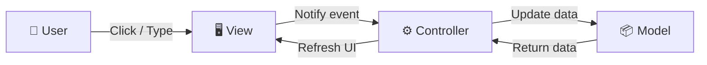
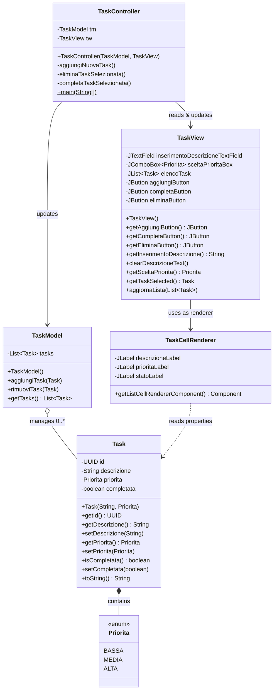
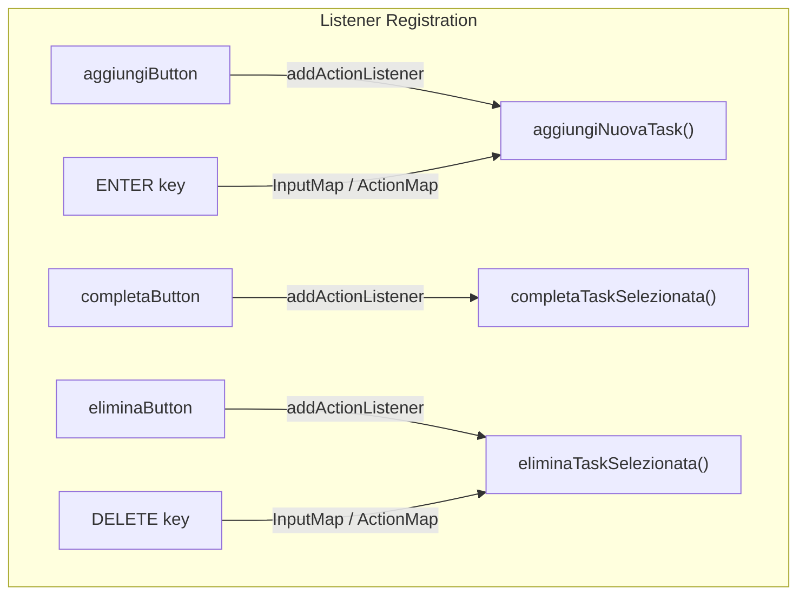
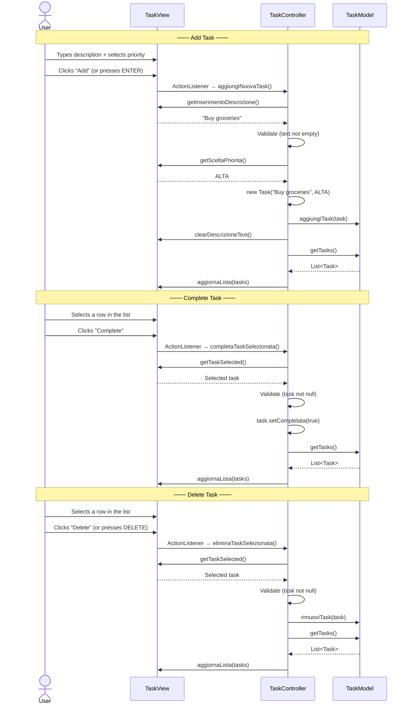
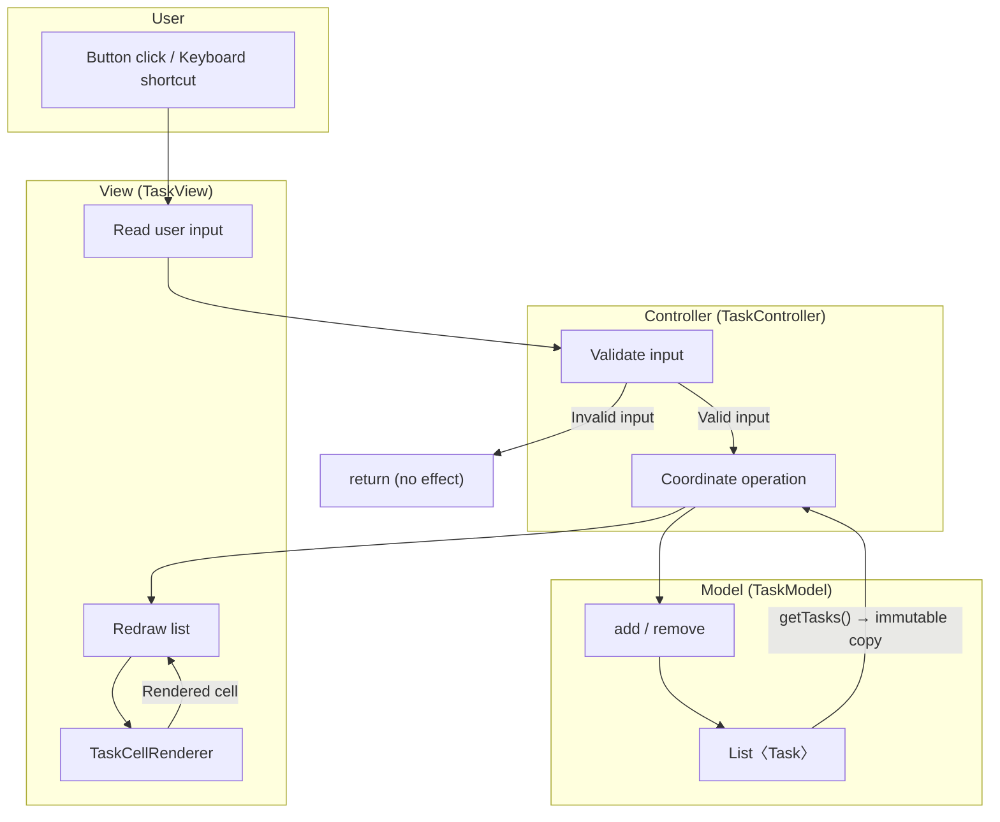

# 📋 Task Manager

A desktop **Task Manager** application built with **Java Swing**, following the **MVC (Model-View-Controller)** architectural pattern.

Manage your tasks with priorities, completion tracking, and keyboard shortcuts — all in a clean, visually rich interface.

---

## Features

- ✅ **Add tasks** with description and priority level (Alta, Media, Bassa)
- ✅ **Mark tasks as completed** with visual strikethrough feedback
- ✅ **Delete tasks** from the list
- ✅ **Color-coded priorities** — 🔴 Alta, 🟡 Media, 🟢 Bassa
- ✅ **Keyboard shortcuts** — `ENTER` to add, `DELETE` to remove
- ✅ **Zebra striping** for improved readability
- ✅ **Custom cell rendering** with multi-line task display

---

## Prerequisites

- **Java 17+** (uses `List.copyOf` and modern language features)

---

## Getting Started

### Compile

```bash
javac model/*.java view/*.java controller/*.java
```

### Run

```bash
java controller.TaskController
```

---

## Keyboard Shortcuts

| Key | Action |
|-----|--------|
| `ENTER` | Add new task |
| `DELETE` | Delete selected task |

---

## Architecture

The application follows the **MVC pattern**, strictly separating data, presentation, and interaction logic into three independent layers.



| Benefit | Description |
|---------|-------------|
| **Separation of concerns** | Each component does one thing and does it well |
| **Maintainability** | Changing the UI doesn't affect business logic and vice versa |
| **Testability** | The Model can be tested independently, without any GUI |
| **Collaboration** | Multiple developers can work in parallel on different layers |

---

## Project Structure

```
taskm/
├── model/                     # 📦 Data layer & business logic
│   ├── Task.java              #    Single task entity (POJO)
│   └── TaskModel.java         #    Task collection & management
├── view/                      # 🖥️ Presentation layer (Swing)
│   ├── TaskView.java          #    Main window & GUI components
│   └── TaskCellRenderer.java  #    Custom list cell rendering
├── controller/                # ⚙️ Interaction layer
│   └── TaskController.java    #    Connects View ↔ Model + entry point
└── docs/
    └── architettura-progetto-completa.md  # Full architecture docs (IT)
```

---

## Class Diagram



---

## Layer Details

### 📦 Model

The Model layer is **completely independent** from the GUI. It has no knowledge of Swing.

#### `Task.java` — The Entity

A POJO representing a single task.

| Field | Type | Description |
|-------|------|-------------|
| `id` | `UUID` (final) | Auto-generated unique identifier |
| `descrizione` | `String` | Task description |
| `priorita` | `Priorita` (enum) | Priority level: `BASSA`, `MEDIA`, `ALTA` |
| `completata` | `boolean` | Completion status |

> [!NOTE]
> The `id` field is `final` and generated via `UUID.randomUUID()` in the constructor, ensuring each task is **uniquely identifiable** throughout its lifetime.

#### `TaskModel.java` — The Collection

Manages the in-memory list of tasks.

| Method | Purpose |
|--------|---------|
| `aggiungiTask(Task t)` | Adds a task to the internal list |
| `rimuoviTask(Task t)` | Removes a task from the list |
| `getTasks()` | Returns an **immutable copy** of the list (`List.copyOf`) |

> [!IMPORTANT]
> `getTasks()` returns `List.copyOf(this.tasks)` — a defensive copy. External callers **cannot modify the internal state** of the Model.

---

### 🖥️ View

The View builds and manages all Swing components. It contains **no business logic** — it only displays data and collects input.

#### `TaskView.java` — Main Window

```
┌──────────────────────────────────────────────────┐
│                    NORTH                         │
│  ┌──────────────────────────────────────────┐    │
│  │  [      Description text field       ]   │    │
│  │  [ Priority ▼ ]    [     Add       ]     │    │
│  └──────────────────────────────────────────┘    │
├──────────────────────────────────────────────────┤
│                   CENTER                         │
│          ┌──────────────────────┐                │
│          │  Task 1              │                │
│          │  Task 2              │                │
│          │  Task 3              │                │
│          │  ...                 │                │
│          │     JScrollPane      │                │
│          └──────────────────────┘                │
├──────────────────────────────────────────────────┤
│                    SOUTH                         │
│       [  Complete  ]      [   Delete   ]         │
└──────────────────────────────────────────────────┘
```

#### Public API for the Controller

| Method | Purpose |
|--------|---------|
| `getAggiungiButton()` | Returns the "Add" button for listener registration |
| `getCompletaButton()` | Returns the "Complete" button for listener registration |
| `getEliminaButton()` | Returns the "Delete" button for listener registration |
| `getInserimentoDescrizione()` | Reads text from the input field |
| `clearDescrizioneText()` | Clears the input field |
| `getSceltaPriorita()` | Reads the selected priority from the combo box |
| `getTaskSelected()` | Returns the currently selected task in the list |
| `aggiornaLista(List<Task>)` | Clears and repopulates the JList |

#### `TaskCellRenderer.java` — Custom Cell Rendering

Each list cell is rendered as a mini two-line panel:

```
┌─────────────────────────────────────────────────┐
│  Buy groceries  [a3f2b1c0]                      │  ← Bold 14pt + abbreviated UUID
│  ● ALTA          ○ Da fare                      │  ← Color-coded priority + status
└─────────────────────────────────────────────────┘
```

**Priority colors:**

| Priority | Color | RGB |
|----------|-------|-----|
| **ALTA** | 🔴 Red | `(210, 45, 45)` |
| **MEDIA** | 🟡 Orange | `(220, 155, 0)` |
| **BASSA** | 🟢 Green | `(50, 155, 50)` |

**Completion feedback:** completed tasks show `✔ Completata` in green with a strikethrough description.

---

### ⚙️ Controller

#### `TaskController.java` — The Orchestrator

The Controller is the **glue** between Model and View. It owns no data and has no UI — its sole responsibility is to **react to user actions**, update the Model, and refresh the View.



Every method follows the same pattern: **read from View → validate → act on Model → refresh View**.



> [!TIP]
> Every method includes a **guard clause** at the top: if input is invalid (empty text, no selection), the method returns immediately with no side effects.

#### Entry Point

The `main` method uses `SwingUtilities.invokeLater()` to ensure all GUI components are created on Swing's **EDT (Event Dispatch Thread)**.

```java
SwingUtilities.invokeLater(() -> {
    TaskModel model = new TaskModel();
    TaskView view = new TaskView();
    TaskController controller = new TaskController(model, view);
});
```

---

## Data Flow Overview



---

## Glossary

| Term | Meaning |
|------|---------|
| **POJO** | Plain Old Java Object — a simple Java class with no framework dependencies |
| **UUID** | Universally Unique Identifier — a 128-bit unique identifier |
| **EDT** | Event Dispatch Thread — Swing's dedicated thread for UI management |
| **ListCellRenderer** | Swing interface defining how each cell of a JList is drawn |
| **InputMap / ActionMap** | Swing mechanism to map keyboard keys to programmatic actions |
| **Guard Clause** | Pattern where error conditions are checked at the beginning of a method with early `return` |
| **Defensive Copy** | Returning a copy of internal data instead of the direct reference, protecting encapsulation |
| **Zebra Striping** | Alternating background colors between even and odd rows for readability |

---

## License

This project is for educational purposes.
