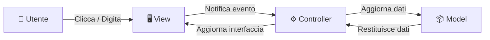
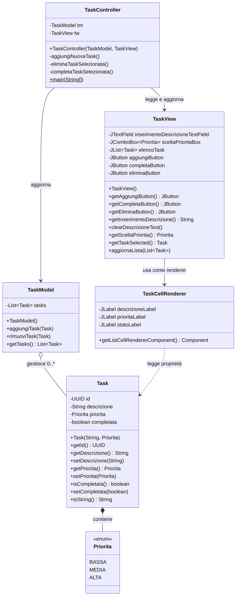
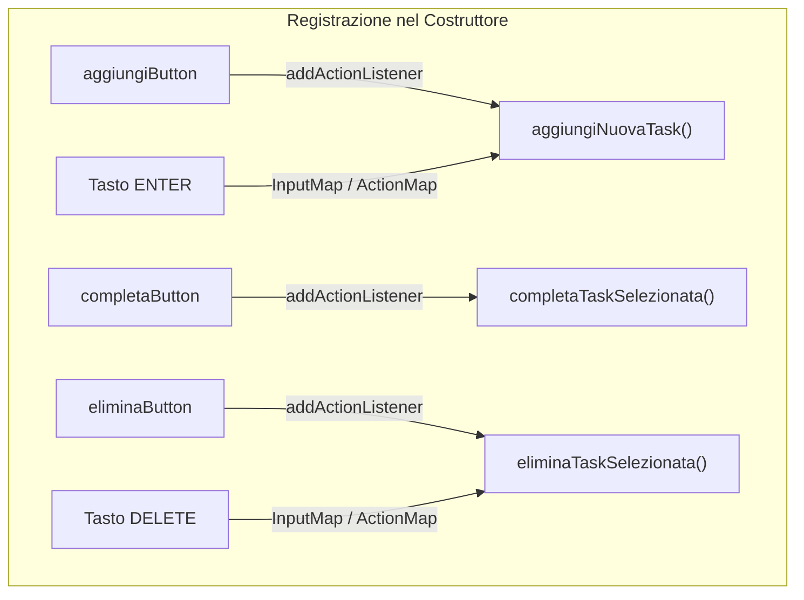
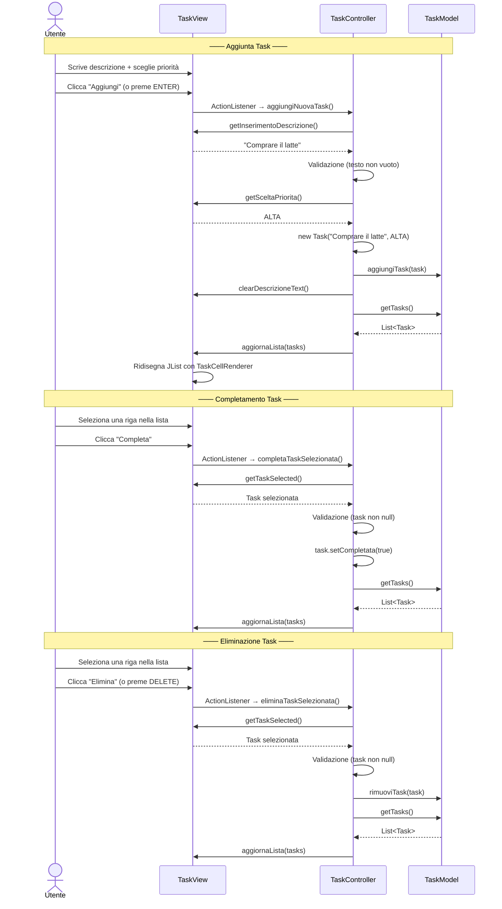
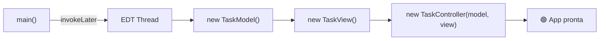
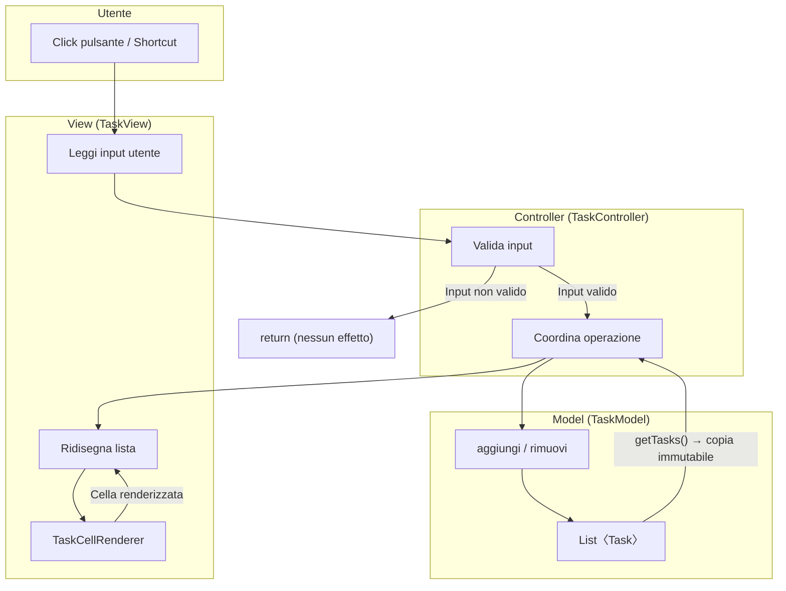

# Task Manager — Documentazione Architetturale

## 1. Panoramica del Progetto

Il **Task Manager** è un'applicazione desktop in **Java** che permette all'utente di gestire una lista di attività (task). Ogni task ha una descrizione, un livello di priorità e uno stato di completamento.

L'applicazione è costruita secondo il pattern architetturale **MVC (Model-View-Controller)**, che separa rigorosamente i dati, la presentazione e la logica di interazione in tre layer indipendenti.

### Perché MVC?



| Vantaggio | Descrizione |
|-----------|-------------|
| **Separazione responsabilità** | Ogni componente fa una sola cosa e la fa bene |
| **Manutenibilità** | Un cambio al layout grafico non tocca la logica e viceversa |
| **Testabilità** | Il Model può essere testato da solo, senza interfaccia grafica |
| **Collaborazione** | Più sviluppatori possono lavorare in parallelo su layer diversi |

---

## 2. Struttura del Progetto

```
taskm/
├── model/                     # 📦 Layer dati e logica di business
│   ├── Task.java              #    Entità singola task (POJO)
│   └── TaskModel.java         #    Collezione e gestione delle task
├── view/                      # 🖥️ Layer presentazione (Swing)
│   ├── TaskView.java          #    Finestra principale e componenti grafici
│   └── TaskCellRenderer.java  #    Rendering personalizzato celle della lista
└── controller/                # ⚙️ Layer interazione
    └── TaskController.java    #    Collega View ↔ Model + entry point
```

---

## 3. Diagramma delle Classi



---

## 4. Layer Model — I Dati

Il layer Model è **completamente indipendente** dalla grafica. Non importa, non conosce e non riferisce nulla di Swing. Contiene due classi.

### 4.1 [`Task.java`](file:///home/carl/projects/test_java/taskm/model/Task.java) — L'entità

Un POJO (Plain Old Java Object) che rappresenta una singola attività.

| Campo | Tipo | Descrizione |
|-------|------|-------------|
| `id` | `UUID` (final) | Identificativo univoco, generato automaticamente alla creazione |
| `descrizione` | `String` | Testo descrittivo dell'attività |
| `priorita` | `Priorita` (enum) | Livello di urgenza: `BASSA`, `MEDIA`, `ALTA` |
| `completata` | `boolean` | Stato di completamento |

> [!NOTE]
> L'`id` è dichiarato `final` e viene generato con `UUID.randomUUID()` nel costruttore. Questo garantisce che ogni task sia **univocamente identificabile** per tutta la sua esistenza, senza possibilità di collisioni.

L'enum `Priorita` è definito come **classe interna** di `Task`:

```java
public enum Priorita {
    BASSA, MEDIA, ALTA
}
```

### 4.2 [`TaskModel.java`](file:///home/carl/projects/test_java/taskm/model/TaskModel.java) — La collezione

Gestisce la lista delle task in memoria. È il **"magazzino dati"** dell'applicazione.

| Metodo | Cosa fa |
|--------|---------|
| `aggiungiTask(Task t)` | Aggiunge una task alla lista interna |
| `rimuoviTask(Task t)` | Rimuove una task dalla lista |
| `getTasks()` | Restituisce una **copia immutabile** della lista (`List.copyOf`) |

> [!IMPORTANT]
> `getTasks()` restituisce `List.copyOf(this.tasks)` — una copia difensiva. Questo significa che chi riceve la lista **non può modificarla dall'esterno**, proteggendo l'integrità dei dati del Model.

---

## 5. Layer View — L'Interfaccia Grafica

Il layer View costruisce e gestisce tutti i componenti Swing. **Non contiene logica di business**: sa solo mostrare dati e raccogliere input.

### 5.1 [`TaskView.java`](file:///home/carl/projects/test_java/taskm/view/TaskView.java) — La finestra principale

#### Layout della finestra

La finestra usa un `BorderLayout` diviso in tre aree:

```
┌──────────────────────────────────────────────────┐
│                    NORD                          │
│  ┌──────────────────────────────────────────┐    │
│  │  [    Campo di testo descrizione     ]   │    │
│  │  [ Priorità ▼ ]  [    Aggiungi     ]     │    │
│  └──────────────────────────────────────────┘    │
├──────────────────────────────────────────────────┤
│                   CENTRO                         │
│          ┌──────────────────────┐                │
│          │  ┌────────────────┐  │                │
│          │  │ Task 1         │  │                │
│          │  │ Task 2         │  │                │
│          │  │ Task 3         │  │                │
│          │  │ ...            │  │                │
│          │  └────────────────┘  │                │
│          │     JScrollPane      │                │
│          └──────────────────────┘                │
├──────────────────────────────────────────────────┤
│                     SUD                          │
│       [   Completa   ]    [   Elimina   ]        │
└──────────────────────────────────────────────────┘
```

| Area | Layout interno | Componenti |
|------|---------------|------------|
| **NORD** | `GridBagLayout` | `JTextField` (riga 0, span 2 colonne), `JComboBox` + `JButton "Aggiungi"` (riga 1) |
| **CENTRO** | `GridBagLayout` con glue laterale | `JScrollPane` con la `JList<Task>` centrata al 60% della larghezza |
| **SUD** | `GridBagLayout` | `JButton "Completa"` + `JButton "Elimina"` affiancati |

#### Metodi pubblici — L'interfaccia verso il Controller

La View espone metodi che rispettano l'**incapsulamento**: il Controller non accede mai direttamente ai campi privati.

| Metodo | Scopo | Usato dal Controller per... |
|--------|-------|---------------------------|
| `getAggiungiButton()` | Restituisce il pulsante "Aggiungi" | Registrare il listener di click |
| `getCompletaButton()` | Restituisce il pulsante "Completa" | Registrare il listener di click |
| `getEliminaButton()` | Restituisce il pulsante "Elimina" | Registrare il listener di click |
| `getInserimentoDescrizione()` | Legge il testo dal campo di input | Sapere cosa ha scritto l'utente |
| `clearDescrizioneText()` | Svuota il campo di input | Resettare dopo l'aggiunta |
| `getSceltaPriorita()` | Legge la priorità dal combo box | Sapere la priorità scelta |
| `getTaskSelected()` | Restituisce la task selezionata nella lista | Sapere su quale task agire |
| `aggiornaLista(List<Task>)` | Svuota e ripopola la JList | Sincronizzare la vista con i dati aggiornati |

### 5.2 [`TaskCellRenderer.java`](file:///home/carl/projects/test_java/taskm/view/TaskCellRenderer.java) — Il rendering personalizzato

Per default, la `JList` mostra ogni elemento come una singola riga di testo (il risultato di `toString()`). Il `TaskCellRenderer` sovrascrive questo comportamento per creare celle **multi-riga e visivamente ricche**.

#### Struttura di ogni cella

```
┌─────────────────────────────────────────────────┐
│  Comprare il latte  [a3f2b1c0]                  │  ← descrizioneLabel (Bold 14pt)
│  ● ALTA          ○ Da fare                      │  ← prioritaLabel + statoLabel (11pt)
└─────────────────────────────────────────────────┘
```

#### Feedback visivo

````carousel
### Codifica colori Priorità

| Priorità | Colore | Codice RGB |
|----------|--------|------------|
| **ALTA** | 🔴 Rosso | `(210, 45, 45)` |
| **MEDIA** | 🟡 Arancione | `(220, 155, 0)` |
| **BASSA** | 🟢 Verde | `(50, 155, 50)` |
<!-- slide -->
### Stato di Completamento

| Stato | Icona | Effetto sulla descrizione |
|-------|-------|--------------------------|
| **Da fare** | `○ Da fare` (grigio) | Testo normale, nero |
| **Completata** | `✔ Completata` (verde) | Testo ~~barrato~~ e grigio |
<!-- slide -->
### Altre caratteristiche visive

- **ID abbreviato**: i primi 8 caratteri dell'UUID, mostrati in grigio accanto alla descrizione `[a3f2b1c0]`
- **Zebra striping**: righe pari → sfondo bianco, righe dispari → sfondo grigio chiaro `(243, 243, 243)`
- **Selezione**: la riga selezionata usa i colori di selezione del sistema operativo
````

> [!NOTE]
> Il renderer **non modifica i dati**. Implementa l'interfaccia `ListCellRenderer<Task>`: riceve un oggetto `Task` in sola lettura e restituisce un `JPanel` già composto. Vive interamente nel layer View.

---

## 6. Layer Controller — L'Orchestratore

### 6.1 [`TaskController.java`](file:///home/carl/projects/test_java/taskm/controller/TaskController.java)

Il Controller è il **collante** tra Model e View. Non ha una UI propria e non possiede dati: la sua unica responsabilità è **reagire alle azioni dell'utente**, aggiornare il Model e rinfrescare la View.

#### Costruttore — Registrazione dei listener

Nel costruttore, il Controller:

1. Riceve le reference a `TaskModel` e `TaskView`
2. Registra gli **ActionListener** sui tre pulsanti
3. Registra le **shortcut da tastiera**



#### Shortcut da tastiera

Le shortcut usano il meccanismo **`InputMap` / `ActionMap`** di Swing con scope `WHEN_IN_FOCUSED_WINDOW`, il che significa che funzionano **indipendentemente da quale componente ha il focus**.

| Tasto | Azione |
|-------|--------|
| `ENTER` | Aggiunge una nuova task (equivale a cliccare "Aggiungi") |
| `DELETE` | Elimina la task selezionata (equivale a cliccare "Elimina") |

#### I tre metodi — Ciclo di vita delle operazioni

Ogni metodo segue lo stesso schema: **leggi dalla View → valida → agisci sul Model → aggiorna la View**.



> [!TIP]
> Ogni metodo include un **controllo di sicurezza** iniziale (`guard clause`): se l'input non è valido (testo vuoto, nessuna selezione), il metodo esce subito con `return` senza effetti collaterali.

#### Entry Point — Il `main`

Il metodo `main` è il punto di ingresso dell'applicazione. Utilizza `SwingUtilities.invokeLater()` per garantire che tutti i componenti grafici vengano creati nel **thread EDT** (Event Dispatch Thread) di Swing, come richiesto dalle specifiche della libreria.

```java
SwingUtilities.invokeLater(() -> {
    TaskModel model = new TaskModel();      // 1. Crea il magazzino dati
    TaskView view = new TaskView();          // 2. Crea la finestra grafica
    TaskController ctrl = new TaskController(model, view); // 3. Collega tutto
});
```



---

## 7. Flusso Dati Completo



---

## 8. Glossario Tecnico

| Termine | Significato |
|---------|-------------|
| **POJO** | Plain Old Java Object — classe Java semplice senza dipendenze da framework |
| **UUID** | Universally Unique Identifier — identificativo univoco a 128 bit |
| **EDT** | Event Dispatch Thread — thread dedicato di Swing per la gestione della UI |
| **ListCellRenderer** | Interfaccia Swing che definisce come viene disegnata ogni cella di una JList |
| **InputMap / ActionMap** | Meccanismo Swing per mappare tasti della tastiera ad azioni programmatiche |
| **Guard Clause** | Pattern in cui le condizioni di errore vengono controllate all'inizio del metodo con `return` anticipato |
| **Copia difensiva** | Restituire una copia dei dati interni anziché il riferimento diretto, per proteggere l'incapsulamento |
| **Zebra Striping** | Alternanza di colori di sfondo tra righe pari e dispari per migliorare la leggibilità |
